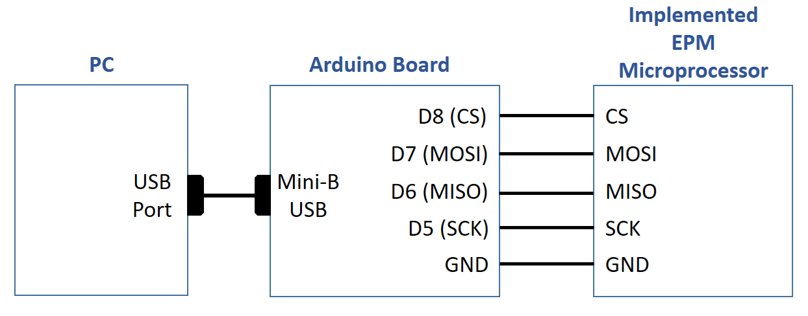
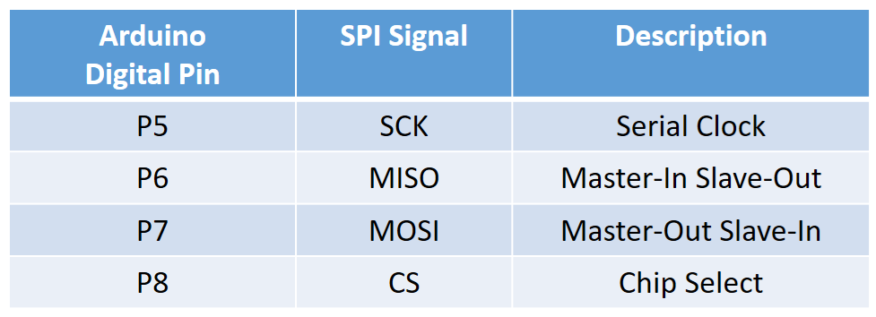
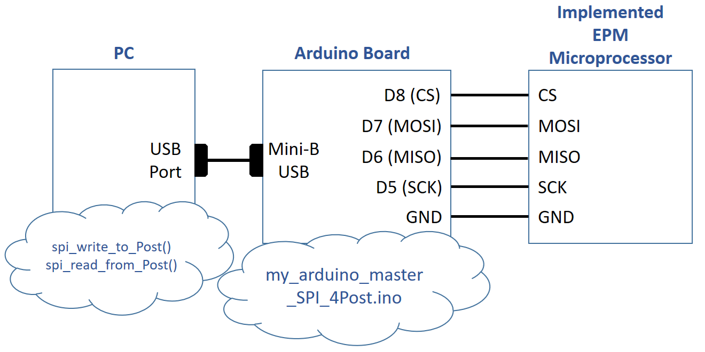
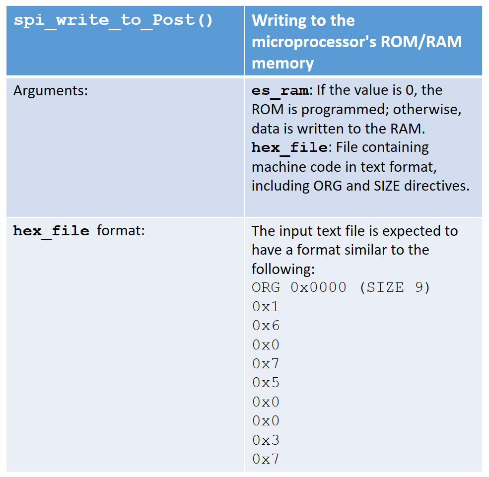
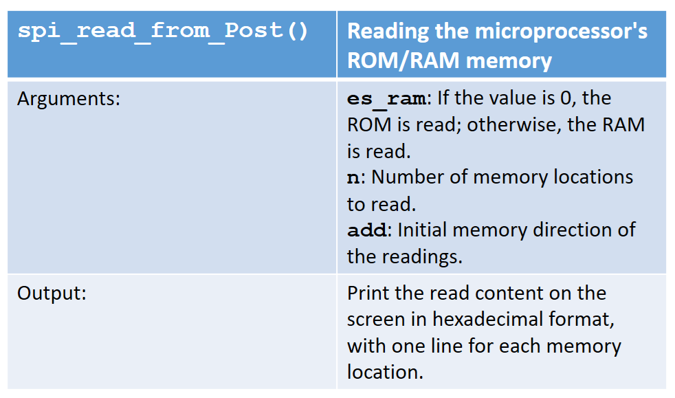

# Programming tools for Packaged Enhanced Post's Machine 

## How it works

This repository contains the source code for the firmware and software that support the programming system for the self-contained processing system, which features an SPI interface and is supported by an Enhanced Post’s Machine (EPM), whose hardware description is located in the following repository:

https://github.com/galaguna/Packaged_Enhanced_Posts_Machine

The programming system requires an Arduino-compatible board and a personal computer (PC). The following figure shows a block diagram of the hardware components that make up the programming system. 

In particular, a generic board with minimal resources, such as the Arduino Nano, is used. The Arduino board serves as an intermediary between the programmer’s computer and the microprocessor device. The programmer controls the operation of the Arduino board via serial communication established through the USB cable. For its part, the Arduino board acts as an SPI master and controls four digital pins (pins `[P5:P8]`) to exchange SPI transfers with the microcontroller. The following table shows the assignment of the Arduino board’s digital pins to the SPI interface signals.

 

Both the software that runs on the terminal computer and the firmware used to program the Arduino board are in the following folders in this repository:

- `PC_Programmer_Terminal`: Folder containing the Python code for the program to be run on the personal computer (PC) to control the operation of the Arduino board, specifying the order and nature of the SPI transfers in order to write to and read from the microprocessor’s code and data areas. This program uses serial communication (9600 bps, 8 bits, one stop bit, no parity bit) to interact with and exchange information—via text strings with ASCII-encoded characters—with the Arduino board.  

- `Arduino_SPI_Programmer`: Folder containing the C code, which must be compiled and uploaded to the Arduino board to operate the master SPI interface that interacts with the microprocessor. The firmware compiled from the code in this folder allows the Arduino board, on the one hand, to interact with the programmer via a serial communication interface—using the Mini-B USB connector and the CH340 bridge chip—and, on the other hand, to control the SPI communication signals with the microcontroller. The SPI communication speed, which is defined by the `SCK` signal generated by the Arduino board, is set to 191 Hz, a speed slow enough to minimize communication errors with the microprocessor and suitable for programming purposes.

The following figure shows the block diagram of the programming system and its connection to the software and firmware that support its operation.

## How to test

First, make sure the Arduino board is programmed with the firmware from the `Arduino_SPI_Programmer` folder and connected to the programmer’s PC. Once the Arduino board has been programmed, it is essential to close the Arduino development environment, especially to ensure that the serial monitor tool is not open. It is essential that the serial port, where the PC detects the Arduino board, be available for our program.

Second, ensure that the digital pins on the Arduino board used as SPI terminals (pins `[P5:P8]`), along with the ground pin, are properly connected to the corresponding SPI terminals on the EPM microprocessor implementation. Of course, the processing system supported by the microprocessor must be powered on, reset, and in programming mode.

Finally, from the terminal computer, the programmer can modify and read the contents of all memory locations, both code (ROM) and data (RAM), in the EPM microprocessor. To do this, the main file `my_Post_SPI_lex_programmer.py` is in the `PC_Programmer_Terminal` folder; it must be run on the PC and includes the functions declared in the file `comPC_term_4Arduino_wMaster_SPI_4Post.py`. The latter file contains the serial communication functions, while the former contains the functions `spi_write_to_Post()` and `spi_read_from_Post()`. 

The `spi_write_to_Post()` function is used to write (load) machine code and data, while the `spi_read_from_Post()` function is used to read (retrieve) information.

The following figure shows the arguments of the `spi_write_to_Post()` function:

The `spi_write_to_Post()` function takes as input a text file and an argument that specifies the type of space to which the data will be written. This function uses a simple lexical-syntactic analysis to extract information from the contained data and the destination address, using the `ORG` and `SIZE` directives found within the text file itself.

Ideally, the `hex` file containing the machine code should be generated by the assembler program available in the following repository:

https://github.com/galaguna/PostCPU_Assembler

An experienced programmer could also manually code the contents of the `hex` file.

The following figure shows the arguments of the `spi_read_from_Post()` function:

The `spi_read_from_Post()` function requires only the type of space to be read, as well as the starting address and the number of locations to be read, as input arguments.

## How to cite

If you mention this project in a publication, I ask that you include the following citation for it

Laguna-Sanchez, G.A. (2026). Programming tools for Packaged Enhanced Post's Machine.  
https://github.com/galaguna/PostCPU_Programming_tools

